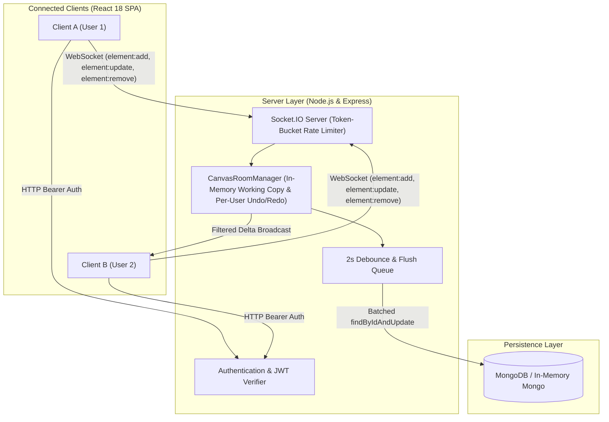

# Collaborative Whiteboard

Collaborative Whiteboard is a real-time, multi-user visual collaboration application built with React, Node.js, Express, Socket.IO, and MongoDB. The system enables multiple concurrent participants to collaborate in isolated canvas rooms with low-latency delta synchronization, granular drawing tools (brush, shapes, text, eraser), server-side per-user undo/redo stacks, and debounced database persistence.

## Architecture

The application separates real-time drawing operations into lightweight WebSocket delta broadcasts while maintaining an in-memory working copy per canvas. Changes are asynchronously flushed to MongoDB using a 2-second debounce timer, on client disconnection, and on graceful process termination.



## Real-Time Event Protocol

The WebSocket communication layer enforces granular delta synchronization. With the exception of `canvas:load` sent exclusively upon room entry, no event transmits full canvas state.

| Event Name | Direction | Payload Schema | Purpose |
| :--- | :--- | :--- | :--- |
| `joinCanvas` | Client -> Server | `{ canvasId: string }` | Requests entry to room; verifies ownership or shared permissions |
| `canvas:load` | Server -> Client | `{ canvasId: string, elements: Element[] }` | Transmits complete initial canvas snapshot to joining socket |
| `presence:join` | Server -> Client | `{ canvasId: string, userId: string }` | Broadcasts new user arrival to peer sockets in room |
| `presence:leave` | Server -> Client | `{ canvasId: string, userId: string }` | Broadcasts user departure to peer sockets in room |
| `element:add` | Bidirectional | `{ canvasId: string, element: Element }` | Transmits newly created stroke or shape |
| `element:update` | Bidirectional | `{ canvasId: string, id: string, patch: object }` | Transmits batched coordinate or point modifications |
| `element:remove` | Bidirectional | `{ canvasId: string, id: string }` | Transmits deletion of an element (via eraser or undo) |
| `undo` | Client -> Server | `{ canvasId: string }` | Reverts requesting user's most recent action |
| `redo` | Client -> Server | `{ canvasId: string }` | Re-applies requesting user's most recent undone action |
| `error` | Server -> Client | `{ message: string, details?: any }` | Reports validation failure, rate limit exhaustion, or permission error |
| `unauthorized` | Server -> Client | `{ message: string }` | Denies room access due to missing or invalid permissions |

## Protocol Benchmark Results

A synthetic benchmark (`scripts/measure-protocol.js`) compares legacy full-array broadcasting against the hardened delta synchronization protocol during a continuous 200-point freehand stroke at 60 Hz input. Figures are verified by `server/tests/metrics.test.js`.

| Metric | Monolithic Full-Array (Legacy) | Granular Delta Protocol (Hardened) | Improvement |
| :--- | :--- | :--- | :--- |
| WebSocket Events | 200 emissions | 69 emissions | 65.50% reduction |
| Total Payload Data | 362,930 bytes (~363 KB) | 124,762 bytes (~125 KB) | 65.62% reduction |
| Database Writes | 200 writes | 1 write | 99.50% reduction |

Benchmark script execution:
```bash
node scripts/measure-protocol.js
```

## Running Locally

The project supports zero-setup local execution using an embedded in-memory MongoDB server. No external database installation is required for development.

### Prerequisites
- Node.js (v18.0.0 or higher; tested on v20.x, v22.x, v24.x)
- npm (v9.0.0 or higher)

### Environment Configuration

Server configuration (`server/.env`):
```env
PORT=5000
MONGODB_URI=
JWT_SECRET=replace_this_with_a_secure_random_key_of_at_least_32_characters
CORS_ORIGINS=http://localhost:3000
NODE_ENV=development
USE_MEMORY_DB=true
```

Client configuration (`client/.env`):
```env
REACT_APP_API_URL=http://localhost:5000
REACT_APP_SOCKET_URL=http://localhost:5000
```

### Installation and Startup

1. Start the Server:
   ```bash
   cd server
   npm install
   npm start
   ```
   The server boots on port 5000 with an in-memory MongoDB instance when `USE_MEMORY_DB=true`.

2. Start the Client:
   ```bash
   cd client
   npm install --legacy-peer-deps
   npm start
   ```
   The client opens automatically at `http://localhost:3000`.

## Testing

The project contains unit and integration test suites covering API security, WebSocket protocol validation, rate limiting, room isolation, per-user undo/redo, and client state reducers.

### Server Tests
```bash
cd server
npm test
```
Executes Jest test suites:
- `tests/server-hardening.test.js`: Zod configuration validation, registration, password hashing, JWT authentication, rate limiting, and route protection.
- `tests/realtime-protocol.test.js`: Unauthenticated socket rejection, room authorization, delta broadcasting, cross-room isolation, late joiner state retrieval, per-user undo/redo independence, debounced persistence across server restarts, payload limits, and room memory eviction.
- `tests/metrics.test.js`: Validates that benchmark figures in `metrics/protocol.json` match simulated protocol performance.

### Client Tests
```bash
cd client
npm test -- --watchAll=false
```
Executes React test suites:
- `src/__tests__/boardReducer.test.js`: Reducer transitions for delta additions, updates, removals, and tool changes.
- `src/__tests__/element.test.js`: Element creation, seed generation, rough element hydration, and SVG stroke calculation.
- `src/__tests__/throttle.test.js`: Trailing-edge point batch throttle verification.

### Code Style Verification
```bash
cd server
npm run format:check
```

## Limitations

- **Single Process Instance**: The current architecture maintains room state in Node.js process memory. Horizontal scaling across multiple processes or containers requires a Redis pub/sub adapter (e.g. `@socket.io/redis-adapter`) and a shared distributed cache.
- **Conflict Model**: Simultaneous updates to the same element ID follow a Last-Write-Wins (LWW) model. The system does not implement Operational Transformation (OT) or Conflict-free Replicated Data Types (CRDT).
- **Per-User Undo/Redo**: Undo stacks are tracked per user in room memory. Because actions modify shared canvas state under last-write-wins, undoing an element created by User A removes that element regardless of whether User B drew over it.
- **Authentication Basics**: JWT tokens expire in 24 hours. Refresh token rotation and multi-factor authentication are out of scope for this release.

## AI Tools Used

This refactoring and architectural hardening was developed with assistance from Google DeepMind's Antigravity agentic coding system.

## Acknowledgements

Source foundation for the canvas drawing tool: [Fill in source URL or reference here]
